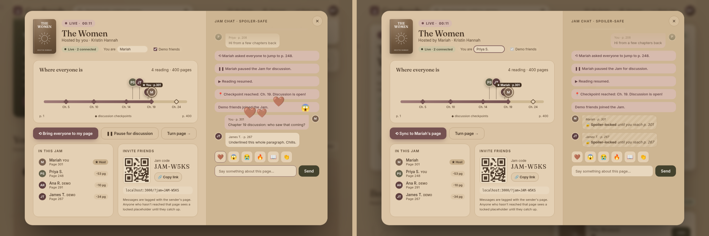

# Goodreads redesign prototype: live Book Jam



A single-page Goodreads homepage concept (GSAP library intro, bookshelf, Book Jam) plus a
tiny in-memory Node server that makes **Book Jam actually sync between browser tabs and devices**.

## Run it

Requires Node 18+.

```bash
npm install        # installs one dependency: ws
npm start          # → Book Jam mock server on http://localhost:3000
```

1. Open **http://localhost:3000/?name=Mariah** and click **▶ Start a Jam**.
2. In the Jam panel, click **🔗 Copy link** (or read the link under the QR code), e.g.
   `http://localhost:3000/?jam=JAM-AB12`.
3. Open that link in a **second tab, another browser, or another device on your network**
   (add `&name=Priya` to pick a name). The second person lands straight in the session.

Options: `PORT=4000 npm start` changes the port. `HOST=127.0.0.1` keeps it local-only.

### URL parameters
| Param | Effect |
|---|---|
| `?name=Priya` | Display name for this tab (you can also edit "You are …" inside the panel) |
| `?jam=JAM-AB12` | Skip the intro and join that Jam |
| `?bots=1` | When starting a Jam, add 2 simulated demo friends (off by default) |

Each tab gets its own identity (sessionStorage), so two tabs in one browser count as two people.

## What syncs
- **Create / join / leave** with an invite code (`JAM-XXXX`), the share link, or by typing the code on the homepage ("Enter jam code").
- **Presence**: who's in the Jam, online or away. Refreshing within 15 s keeps your seat. If the host leaves, the next person becomes host.
- **Page positions**: each reader's marker on the shared track. "Turn page" moves you by one page.
- **Bring everyone to my page** (host): sends a *request*. Others see a banner and choose **Jump there** or **Not now**. Demo bots always accept.
- **Pause / resume** for discussion (host).
- **Spoiler-safe chat**: every message is tagged with the sender's page. The server only sends the text to readers whose page is at least that page. Everyone else gets a 🔒 locked placeholder, and the real text is sent automatically once they reach that page.
- **Emoji reactions** float up for everyone.
- **Chapter checkpoints** (Ch. 5/10/14/19/24): when the host reaches one, it lights up and a "discussion is open" message goes to all.
- **Live jams on the homepage**: the Book Jam section lists jams currently running on the server, each with a Join button.
- **Demo friends**: the host can tick "Demo friends" to add 2 bots that read, chat and react.

State lives in memory only. Restarting the server clears every Jam.

## Offline fallback
Opening `index.html` directly (`file://`), or a server that can't be reached, falls back to the
original simulated Jam (fake friends, local only). The panel shows "Offline demo".

## Files
- `index.html`: the whole front end (inline CSS/JS, GSAP from CDN). Built from `src/` (`cat src/head.html src/body.html` + `<script>` with `src/app1.js src/app2.js src/app3.js`).
- `server/server.js`: plain `node:http` + `ws`. Endpoints: `/` (page), `/ws` (WebSocket), `/api/jams`, `/healthz`.
- `screenshots/`: screenshots from the two-browser end-to-end test.
- `package.json` (repo root): `npm start` runs `server/server.js`.

## WebSocket protocol (JSON)
Client → server: `hello{id,name}`, `create{book,bots?}`, `join{code}`, `leave`, `rename{name}`, `page{page}`, `turn`,
`bring`, `pause{paused}`, `chat{text}`, `react{emoji}`, `bots{on}`.
Server → client: `hello`, `created{code}`, `state{jam}`, `history{msgs}`, `msg{msg, unlocked?}`, `react{emoji,name}`,
`bring{page,name}`, `error{message}`.

## Deploying (Render free web service)
- Build command: `npm install`. Start command: `npm start`. Health check: `/healthz`.
- The server listens on `process.env.PORT` (default 3000) and binds `0.0.0.0`.
- Invite links use `window.location.origin`, and the client switches to `wss://` automatically on https.
- On the free tier, the service sleeps after about 15 minutes idle (cold start takes roughly 30–60 s), and in-memory Jams reset on every restart or sleep.
