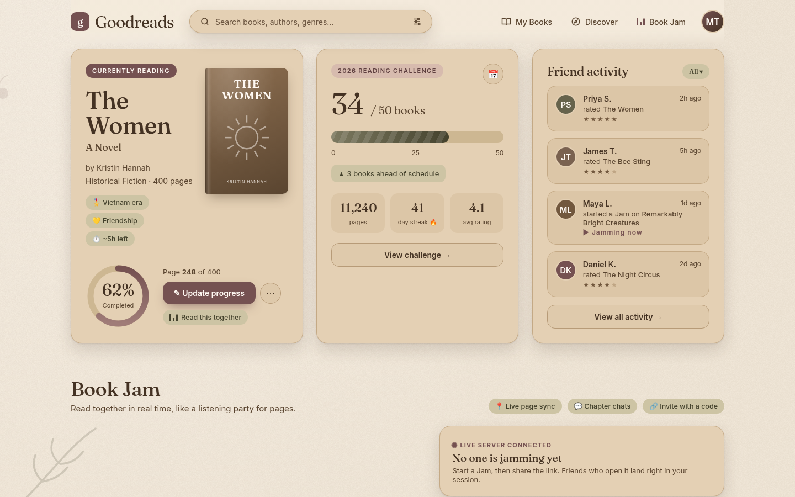
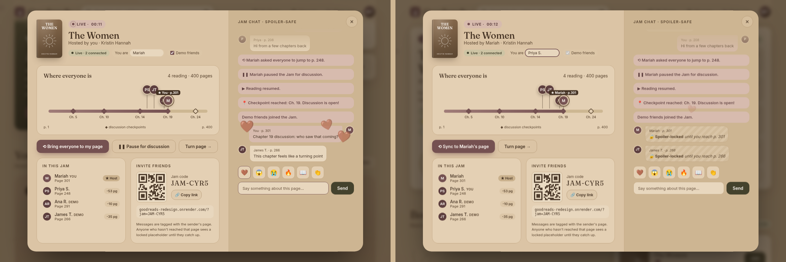
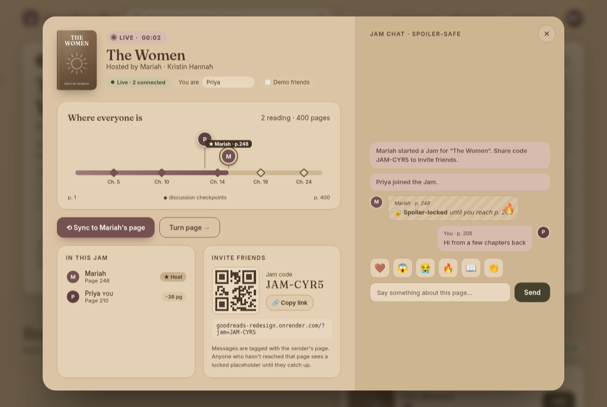

# Goodreads Redesign: Book Jam

A concept redesign of the Goodreads homepage. The goals are to make it **more interpretable, more animated, and less cluttered by hyperlinks**. Inline text links are replaced with cards, chips, tabs and a few strong buttons. The page has a library-themed GSAP intro, an interactive bookshelf and **Book Jam**, a live book club that works like a Spotify Jam for books.

### ▶ Live demo: **https://goodreads-redesign.onrender.com**

> Hosted on Render's free tier. After about 15 minutes with no visitors the service sleeps, so the first visit can take **30–60 seconds** to wake up. Jams are kept in memory and reset whenever the service restarts or sleeps.



## Features

**Homepage & motion**
- **Page-flip intro**: an open book on a warm dark backdrop flips six pages in 3D (GSAP timeline, perspective, page lift and shading), then opens into the homepage. Press Skip, Enter or Esc to skip it.
- **Animated bookshelf**: spines drop onto a wooden shelf with a bounce. Hover pulls a book out. Click turns it and flips open a detail card with "Jam it" and "Review".
- **Scroll reveals & parallax** (ScrollTrigger), a **reading-progress ring** that fills to 62%, a **2026 reading challenge** bar that animates to 34/50, count-up stats, and a "Picked for you" carousel.
- **Currently Reading**, **Friend activity**, slim nav (search, My Books, Discover, Book Jam), no link walls.
- **Reduced motion**: with `prefers-reduced-motion` on, the intro is skipped and everything renders in its final state without animation.
- Responsive down to phone widths. Book covers are drawn with CSS gradients, with no image dependencies.

**Book Jam: a live book club**
- **Start a Jam** and get an invite code (`JAM-XXXX`), a QR-style badge and a real **invite link** built from the site's own URL. Friends join from the link, by typing the code, or from the "live jams" list on the homepage.
- **Shared progress track**: every reader's avatar sits at their current page and moves live. The People list shows who is in sync with the host and who is ahead or behind.
- **Spoiler-safe chat**: each message is tagged with the sender's page. The server only sends the text to readers who have reached that page. Everyone else sees a 🔒 locked placeholder that unlocks automatically when they catch up.
- **Bring everyone to my page**: the host sends a *request*, and each reader chooses **Jump there** or **Not now**.
- **Chapter checkpoints** (Ch. 5/10/14/19/24): when the host reaches one, it lights up and discussion opens for everyone.
- **Emoji reactions** float up on every screen. The host can **pause/resume** for discussion, and anyone can **Turn page**.
- Optional **demo friends** (two bots) for trying it alone. They're off by default.
- Opened as a local file, or with no server, it falls back to a fully simulated offline demo.

| Host and guest in the same Jam | Guest behind the host: spoiler lock |
|---|---|
|  |  |

## Design palette

An earthy, vintage, pastoral-painting mood.

| Role | Name | Hex |
|---|---|---|
| Page background | Cream | `#F3EADB` |
| Cards, panels | Latte | `#DBC4A5` (card tint `#E4D0B4`) |
| Primary buttons, accents | Mauve | `#755151` |
| Body text, shelf wood, intro | Café Noir | `#443223` |
| Book Jam card, dark buttons | Deep Olive | `#44422D` |
| Chips, challenge bar | Cedar | `#7C7960` |
| Stars, shelf wood | Clockwork | `#72583E` |
| Secondary tones, covers | Weathered | `#A08670` |
| Text on dark surfaces | Linen | `#FFF9F3` |

Typography: **Fraunces** (serif headings) and **Inter** (body). Text and background pairs were checked against WCAG AA contrast. For example, body text on cream is 10.2:1 and on cards 8.1:1.

## Tech stack
- **Front end:** a single `index.html` with vanilla HTML, CSS and JavaScript. It uses [GSAP 3](https://gsap.com) and ScrollTrigger from the jsDelivr CDN, and Google Fonts.
- **Server:** Node 18+ with plain `node:http` and [`ws`](https://github.com/websockets/ws) (the only dependency). All state is in memory.

## Project structure
```
index.html          # the whole front end (built from src/)
src/
  head.html         # <head> + all CSS
  body.html         # markup
  app1.js           # mock data, covers, homepage rendering
  app2.js           # bookshelf, page-flip intro, scroll animations
  app3.js           # Book Jam client (live WebSocket mode + offline demo)
server/server.js    # static page, /ws WebSocket, /api/jams, /healthz
package.json        # npm start -> node server/server.js
screenshots/
```
If you edit `src/`, rebuild `index.html`:
```bash
{ cat src/head.html src/body.html; echo "<script>"; cat src/app1.js src/app2.js src/app3.js; echo "</script>"; echo "</body></html>"; } > index.html
```

## Run locally
```bash
npm install     # installs ws
npm start       # http://localhost:3000
```
1. Open `http://localhost:3000/?name=Mariah` and click **▶ Start a Jam**.
2. Click **🔗 Copy link** in the Jam panel.
3. Open the link in a second tab, browser or device, adding `&name=Priya` if you like. Each tab is a separate reader.

Use `PORT=4000 npm start` to change the port. `HOST=127.0.0.1` keeps the server local-only.

### URL parameters
| Param | Effect |
|---|---|
| `?name=Priya` | Your display name in this tab (also editable in the Jam panel) |
| `?jam=JAM-AB12` | Skip the intro and join that Jam |
| `?bots=1` | Add two demo friends when you start a Jam |

## Deploy on Render
The live demo is a **free Render web service** built from this public repo: runtime Node, build `npm install`, start `npm start`, region Oregon. Optionally add a health check at `/healthz`. The server reads `process.env.PORT` and binds `0.0.0.0`. Invite links use `window.location.origin`, and the client switches to `wss://` on https.

**Auto-deploy note:** the service was connected by public repo URL, without Render's GitHub app, so Render isn't notified of pushes. After pushing, trigger a deploy manually from the Render dashboard (**Manual Deploy → Deploy latest commit**) or with the Render API/CLI. To make pushes deploy automatically, install the **Render GitHub app** for this repo (Render dashboard → Account settings → GitHub), then reconnect the service's repository.

## Known limits
- Demo only. All state is **in memory**, so jams vanish on restart, redeploy or free-tier sleep.
- **No authentication**. Names are self-chosen and anyone with a link can join. There is only basic hardening (message size limit, cap on live jams).
- Mock data throughout: books, friends and stats are placeholders. "Copy link" works, but other actions (Update progress, Review, and so on) only show a notification.
- GSAP and fonts load from CDNs. Without them, the page still works but doesn't animate.
